<p align="center">
  
</p>
<h1 align="center">Pocket Bookshelf</h1>
<p align="center">
  A small self-hosted reading log: what you read, what you thought of it, the lines worth keeping, and what to read next.<br>
  <b>One binary · one SQLite file · one volume.</b> Book details and covers from Open Library and Google Books.
</p>
<p align="center">
  <a href="https://github.com/abjelosevic88/pocket-homelab-bookshelf/actions"></a>
  <a href="https://github.com/abjelosevic88/pocket-homelab-bookshelf/pkgs/container/pocket-homelab-bookshelf"></a>
  <a href="LICENSE"></a>
</p>

---

Goodreads is a social network, and StoryGraph is too. This is just your notebook, built around four things:

- **Add a book in seconds.** Type a title, author or ISBN. The details and cover come from Open Library (no key) and Google Books (free key), and the cover is saved with your data. Pick *Want to read*, *Reading* or *Read*, and you're done.
- **Say what you thought.** Half-star ratings from ½ to 5, your thoughts in your own words, favourites, tags. When you finish a book, the app asks for a rating and a few words while it's still fresh.
- **Keep the good lines.** Save quotes with a page number and a note, or import every Kindle highlight in one go. A random one comes back to you on the home page.
- **Get to know the authors.** Every author gets a page with a short biography and photo, filled in automatically: how many of their books you read, your average rating, and the rest of their bibliography to plan from.
- **Plan what's next.** Want-to-read books form a queue you can reorder, pencil in for a month and start with one tap. A yearly goal tells you whether you're ahead or behind.

<p align="center">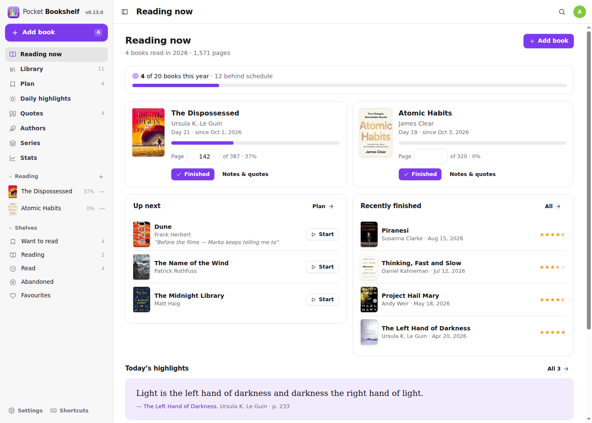</p>

<table>
  <tr>
    <td width="50%">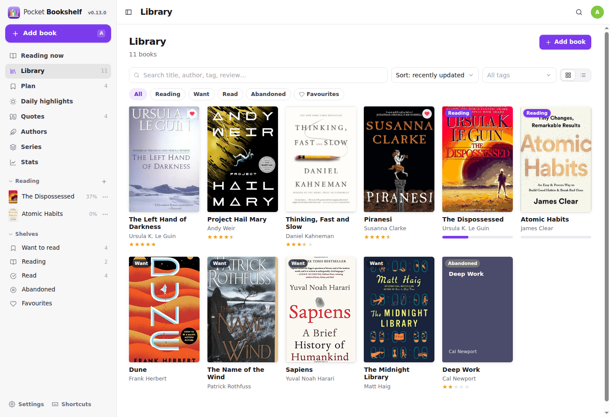</td>
    <td width="50%">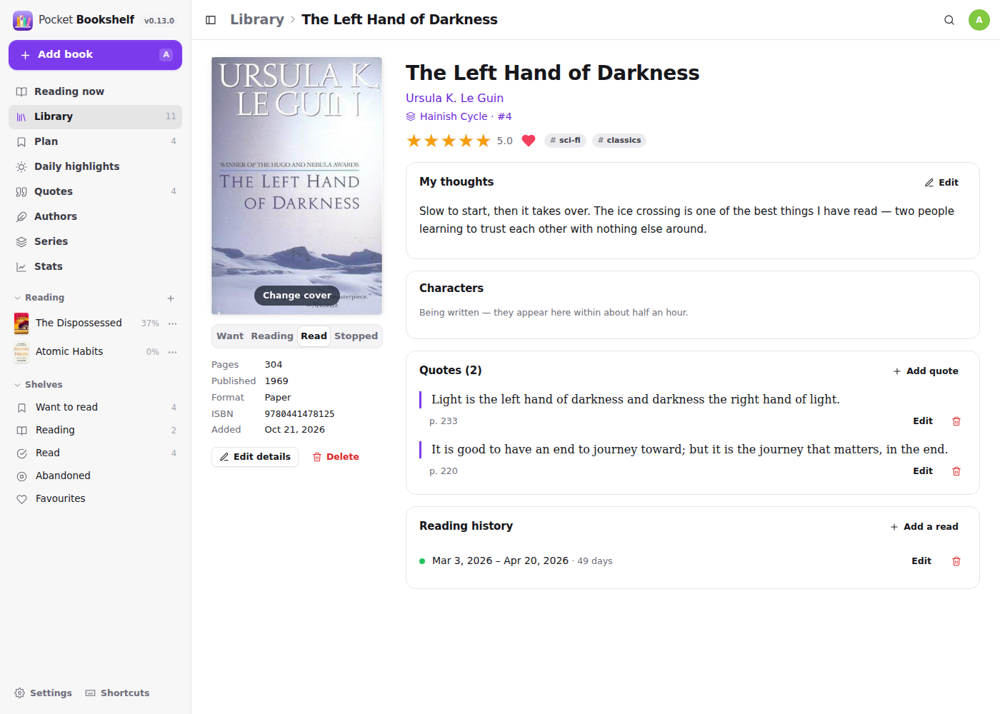</td>
  </tr>
  <tr>
    <td align="center"><sub>The library: covers, ratings, status, filters and search.</sub></td>
    <td align="center"><sub>A book: half-star rating, your thoughts, quotes, every time you read it.</sub></td>
  </tr>
  <tr>
    <td width="50%">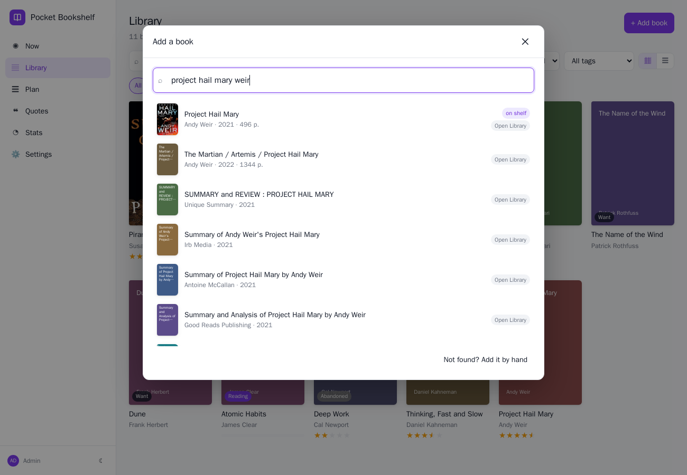</td>
    <td width="50%">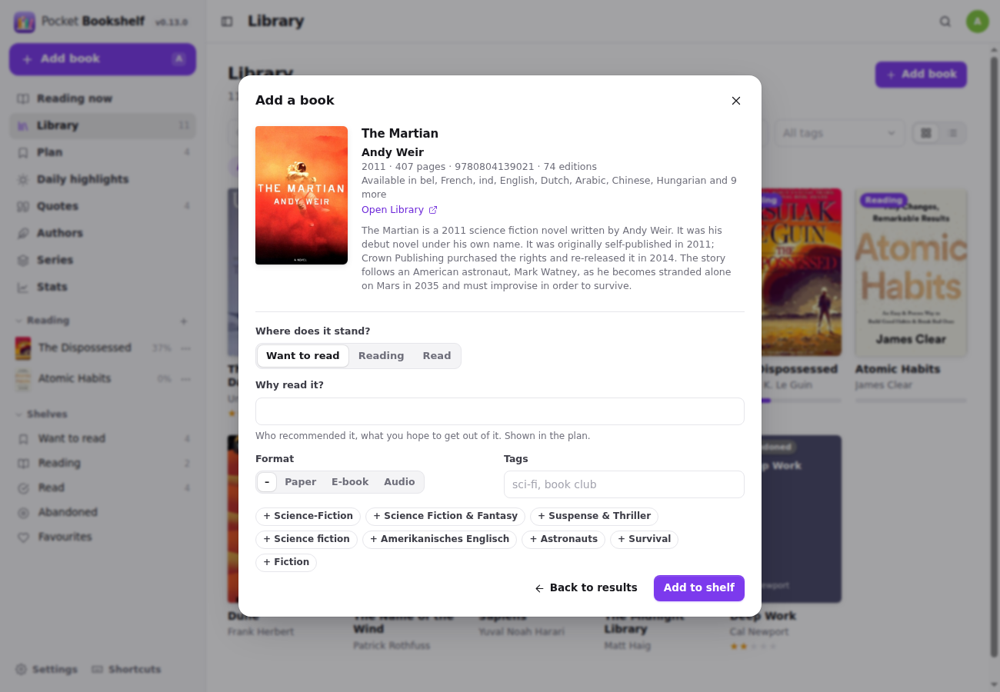</td>
  </tr>
  <tr>
    <td align="center"><sub>Search by title, author or ISBN…</sub></td>
    <td align="center"><sub>…pick it and say where it stands. Subjects become one-tap tags.</sub></td>
  </tr>
  <tr>
    <td width="50%">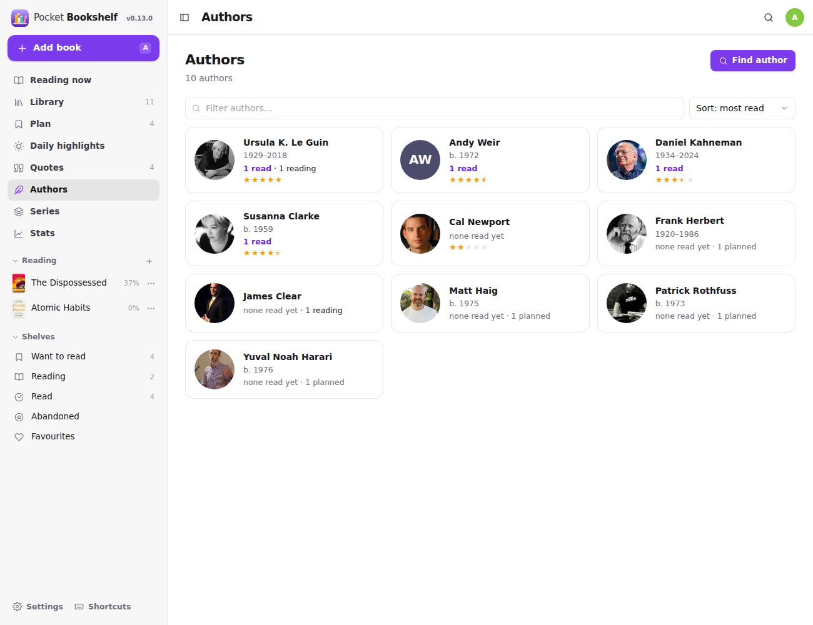</td>
    <td width="50%">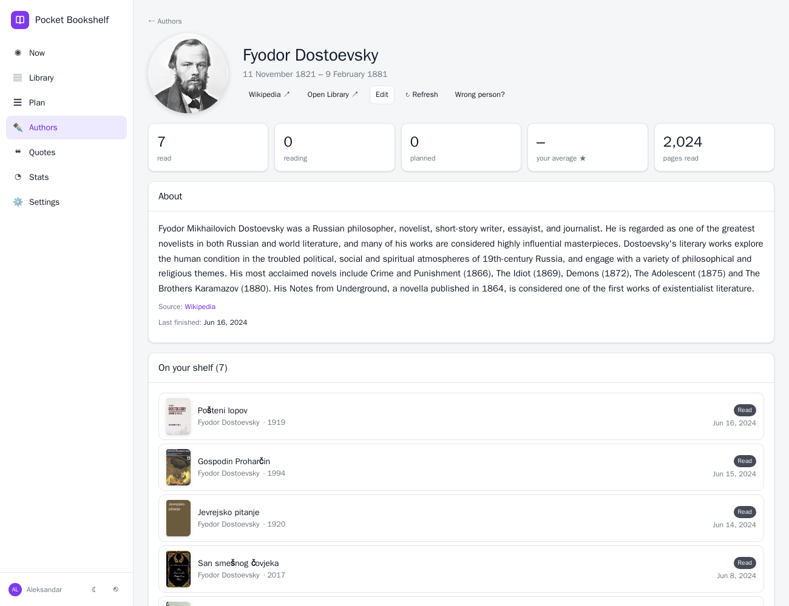</td>
  </tr>
  <tr>
    <td align="center"><sub>Authors, filled in from Open Library and Wikipedia.</sub></td>
    <td align="center"><sub>An author: bio, what you read, everything else they wrote.</sub></td>
  </tr>
  <tr>
    <td width="50%">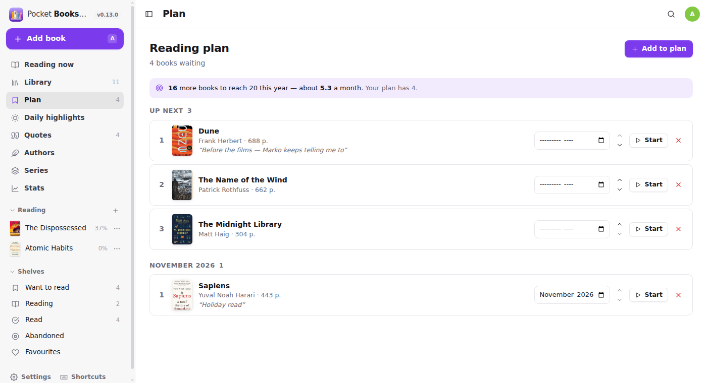</td>
    <td width="50%">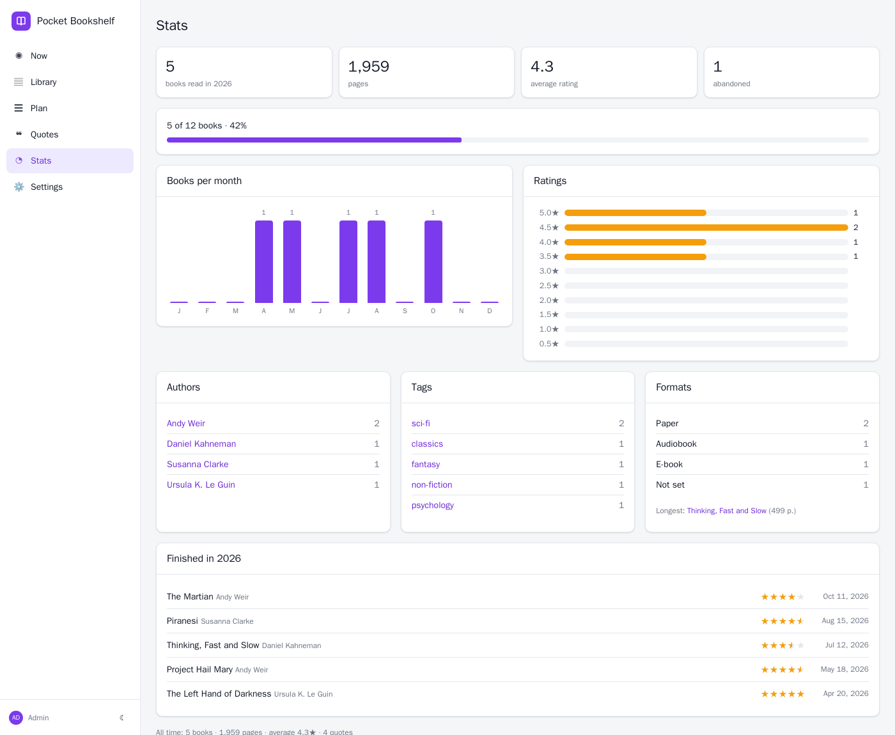</td>
  </tr>
  <tr>
    <td align="center"><sub>The plan: a queue you can reorder, plus months.</sub></td>
    <td align="center"><sub>Stats per year: pace, ratings, authors, tags, formats.</sub></td>
  </tr>
</table>

<p align="center">
  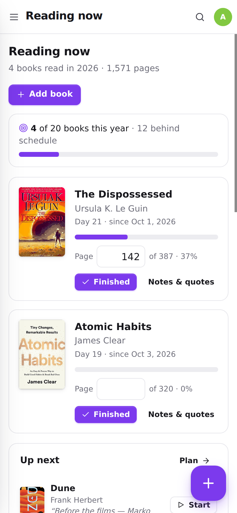&nbsp;&nbsp;
  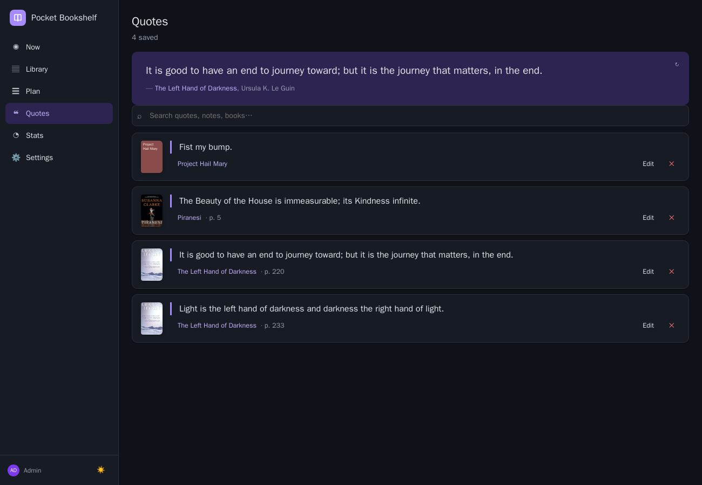<br>
  <sub>Installable PWA with a bottom tab bar, plus dark mode.</sub>
</p>

## Features

| Area | What you get |
|---|---|
| **Books** | Title, subtitle, authors, pages, year, publisher, language, ISBN-10/13, description, format (paper / e-book / audio), tags, cover. Statuses: want to read, reading, read, abandoned. |
| **Your verdict** | Half-star rating (0.5–5), free-text thoughts (start from your own templates, e.g. fiction / non-fiction sections; editable under Settings → Templates), favourite flag. A *Finished* dialog asks for the date, rating and a few words in one go. |
| **Reading history** | Every time through a book, with start and finish dates. Re-reads count again in that year, and abandoned reads are kept separately. Past reads can be added later. |
| **Progress** | Current page with a percentage for books in progress, updated inline from the home page. |
| **Quotes** | Text, page or location, your note. Searchable, with a random one on the home page and the Quotes page. |
| **Plan** | Want-to-read queue: reorder, plan for a month (overdue months are flagged), note why you want to read it or who recommended it, start reading with one tap. Yearly goal with pace (“3 behind schedule”). |
| **Authors** | Created from your books automatically, then filled in from Open Library in the background: short biography (Wikipedia summary when linked), birth/death, photo. Per author: books read, reading, planned, average rating, pages; your books; their full bibliography (English titles where an English edition exists) with one-tap *Want* / *Read it*. Find and follow new authors, edit name (renames it on every book, merges duplicates), bio, dates and photo, re-link to the right Open Library author. |
| **Characters** | Every novel's characters with a short, spoiler-free note on each, in each of your preferred languages (switch on the book page). Written by a language model you already use — `scripts/characters.py` runs `claude -p` or `codex exec` with web search, so no API key is needed — through the API, on a timer. See [Characters](#characters). |
| **Stats** | Per year: books, pages, average rating, books per month, rating distribution, top authors and tags, formats, longest book, the finished list. All-time totals. |
| **Metadata** | Open Library and Google Books, searched in parallel, deduplicated by ISBN. ISBN queries pin the exact edition. Covers are downloaded and stored locally, and any book can re-fetch details and cover later. See [docs/metadata.md](docs/metadata.md). |
| **Import** | Goodreads and StoryGraph CSV exports (ratings, reviews, dates, shelves); missing covers are fetched afterwards by ISBN. **Kindle highlights** from `My Clippings.txt`: matched to your books (also across translations, via Open Library), notes attached, re-imports only add what is new. |
| **People** | Multi-user, and every account has its own private shelf. Admins manage users. Login modes: local accounts, proxy header (Authelia / Authentik / Tinyauth) or none. |
| **Automation** | REST API with personal tokens: `GET /api/v1/dashboard` for Homepage/Glance widgets, `POST /api/v1/books/{id}/progress` from an iOS Shortcut, `GET /api/v1/quotes?random=1` for a quote anywhere. Prometheus `/metrics`, `/healthz`, `/readyz`. |
| **Ops-friendly** | Single static binary with an embedded web app, SQLite with WAL, `VACUUM INTO` backups, JSON and CSV export, multi-arch image (~15 MB), runs as non-root, no outbound calls except catalogue lookups. |

## Quick start

```bash
mkdir pocket-bookshelf && cd pocket-bookshelf
curl -O https://raw.githubusercontent.com/abjelosevic88/pocket-homelab-bookshelf/main/docker-compose.yml
docker compose up -d
# open http://localhost:8080 and create your account
```

Or with plain Docker:

```bash
docker run -d --name pocket-bookshelf -p 8080:8080 -v ./data:/data -e TZ=Europe/Berlin \
  ghcr.io/abjelosevic88/pocket-homelab-bookshelf:latest
```

Want to look around first? Add `-e DEMO_DATA=true -e AUTH_MODE=none` to get a sample shelf with no login.

Binaries for Linux, macOS and Windows are attached to every [release](https://github.com/abjelosevic88/pocket-homelab-bookshelf/releases), and a systemd unit is in [deploy/systemd](deploy/systemd).

## Configuration

Everything is an environment variable with a sensible default. The important ones:

| Variable | Default | Notes |
|---|---|---|
| `TZ` | `UTC` | Decides what “today” is for finish dates and the current year. Set it. |
| `BASE_URL` | – | Public URL (informational). |
| `DATA_DIR` | `/data` | Database, covers and backups live here. |
| `AUTH_MODE` | `local` | `local` (built-in login, multi-user), `proxy` (trust `Remote-User` from your SSO proxy; users auto-created), `none` (single implicit user with no login, for a trusted LAN only). |
| `ADMIN_EMAIL` / `ADMIN_PASSWORD` | – | Create the first admin without the setup screen. |
| `SECURE_COOKIES` | `false` | Set `true` behind HTTPS. |
| `GOOGLE_BOOKS_API_KEY` | – | Enables Google Books (can also be set in Settings → Metadata). |
| `DEMO_DATA` | `false` | Seed a sample shelf into an empty database. |

The full list is in [docs/configuration.md](docs/configuration.md), and reverse-proxy snippets are in [docs/reverse-proxy.md](docs/reverse-proxy.md).

## Automation

Create a token under **Settings → API tokens**, then:

```bash
# where am I in the book? (iOS Shortcut, n8n, …)
curl -X POST https://bookshelf.example.com/api/v1/books/12/progress \
  -H "Authorization: Bearer pb_…" -H "Content-Type: application/json" -d '{"page": 142}'

# finished it
curl -X POST https://bookshelf.example.com/api/v1/books/12/status \
  -H "Authorization: Bearer pb_…" -H "Content-Type: application/json" \
  -d '{"status": "read", "rating": 4.5, "review": "Slow start, then it takes over."}'

# compact status for a Homepage / Glance widget
curl -H "Authorization: Bearer pb_…" https://bookshelf.example.com/api/v1/dashboard
# → {"reading":2,"read_this_year":14,"yearly_goal":24,"goal_percent":58,"want":9,…}
```

Everything else, including a Homepage `customapi` widget, is in [docs/api.md](docs/api.md).

## Characters

The book page lists each novel's characters with a one- or two-sentence note on each — only what you learn
in the first chapters, so nothing is spoiled — in every preferred language (Settings → Metadata). Non-fiction
gets none.

The app doesn't call a language model itself. `scripts/characters.py` asks it which books are missing
characters, has Claude Code (`claude -p`) or the Codex CLI (`codex exec`) write them — both may search the web
to get the book right — and saves them back. It runs with whatever CLI you're signed in to, so there is no API
key to manage. Run it from cron or a systemd timer next to the app:

```bash
BOOKSHELF_URL=http://localhost:8171 BOOKSHELF_TOKEN=pb_… ENGINE=claude MODEL=sonnet \
  python3 scripts/characters.py          # writes what is missing; exits fast when nothing is
```

Use an admin token to cover every user's books. *↻* on the book page forgets a book's characters so the next
run writes them again; `--book <id>` does it right away. The API is in [docs/api.md](docs/api.md#characters).

## Backups

The database is a single file, and covers sit next to it in `covers/`.

- **UI:** Settings → Backup & data → *Download database* (a consistent `VACUUM INTO` copy).
- **CLI:** `docker exec pocket-bookshelf pocket-bookshelf backup` writes to `/data/backups/`.
- **API:** `GET /api/v1/backup`.
- **Export:** JSON (complete and re-importable) or CSV (one row per book).

Restic / Borg / Backrest users: back up `DATA_DIR`, but snapshot the live `pocket-bookshelf.db` through one of the methods above rather than copying the WAL files raw. See [docs/backup.md](docs/backup.md).

## Development

```bash
make dev      # Go API on :8080 (demo data, no login) + Vite on :5173
make test     # go vet + go test + tsc
make all      # production build: web UI embedded into ./pocket-bookshelf
```

Requires Go 1.22+ and Node 20+. Stack: Go + chi + modernc SQLite (no CGO), and React 19 + Vite + TypeScript with no UI framework. Planned next steps are in [docs/roadmap.md](docs/roadmap.md).

## Credits

Book data and covers come from [Open Library](https://openlibrary.org/) (Internet Archive) and [Google Books](https://books.google.com/). Sibling projects built the same way are [Pocket Habits](https://github.com/abjelosevic88/pocket-homelab-habit-tracker), [Pocket Inventory](https://github.com/abjelosevic88/pocket-homelab-inventory) and [Pocket Invoicing](https://github.com/abjelosevic88/pocket-homelab-invoicing).

## License

MIT
